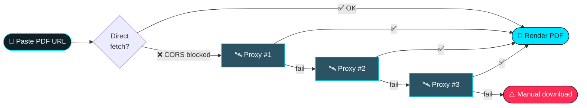

<div align="center">
  
<!-- ═══════════════════════════════════════════════════════════════════════ -->
<!--                        HEX PDF STUDIO · README                          -->
<!-- ═══════════════════════════════════════════════════════════════════════ -->


<!-- ░░ ANIMATED HERO ░░ -->


<!-- ░░ ANIMATED TYPING TITLE ░░ -->
<a href="https://hexsleuth.github.io/HEX-PDF-Studio---TTS/">
  
</a>

<!-- ░░ LIVE / REALTIME BADGES ░░ -->
<p>
  <a href="https://hexsleuth.github.io/HEX-PDF-Studio---TTS/" target="_blank">
    
  </a>
  
  
  
</p>

<p>
  
  
  
  
  
</p>

<!-- ░░ ANIMATED SNAKE / DIVIDER ░░ -->


<br/>

**A blazing-fast, privacy-first PDF Studio that lives entirely in your browser.**
Drop a PDF, paste a link, then let it **read out loud** to you.

<br/>

<a href="https://hexsleuth.github.io/HEX-PDF-Studio---TTS/">
  
</a>

</div>

---

<!-- ═══════════════════════════ TABLE OF CONTENTS ═══════════════════════════ -->

<details open>
<summary><b>📑 &nbsp;Table of Contents</b></summary>

- [✨ Features](#-features)
- [🚀 Quick Start](#-quick-start)
- [🎙️ Text-to-Speech](#️-text-to-speech)
- [🌐 CORS Proxy Engine](#-cors-proxy-engine)
- [📱 Mobile Interface](#-mobile-interface)
- [🧩 How It Works](#-how-it-works)
- [⌨️ Keyboard & Gestures](#️-keyboard--gestures)
- [🛠️ Tech Stack](#️-tech-stack)
- [📊 Live Status](#-live-status)
- [🤝 Contributing](#-contributing)
- [📄 License](#-license)

</details>

---

<!-- ═════════════════════════════ FEATURES ═════════════════════════════ -->

<h2 align="center">✨ Features</h2>

<div align="center">

| 🌟 | Feature | Description |
|:--:|:--------|:------------|
| 📄 | **Instant PDF Rendering** | High-fidelity canvas rendering with crisp zoom from 100% → 400%. |
| 🗣️ | **Built-in Text-to-Speech** | Voices load automatically from your OS — pick a voice, set the rate, hit play. |
| 🖱️ | **Drag & Drop Anywhere** | Drop a `.pdf` file anywhere on the page — no dialog hunting. |
| 📂 | **Open From Device** | Classic file picker for mobile & desktop. |
| 🔗 | **Paste a URL** | Remote PDFs open instantly thanks to automatic CORS proxying. |
| 🛰️ | **Free CORS Proxies** | Multiple fallback proxies rotate automatically when a site blocks cross-origin access. |
| 🔒 | **Zero Uploads** | Files never leave your device. Everything runs client-side. |
| 📱 | **Mobile-First UI** | Collapsible sidebar via ☰, touch-friendly controls, fluid layout. |
| ⚡ | **No Build Step** | Pure HTML/CSS/JS — fork it, host it on Pages, done. |

</div>

---

<!-- ═════════════════════════════ QUICK START ═════════════════════════════ -->

<h2 align="center">🚀 Quick Start</h2>

### Option 1 — Use the live app (recommended)

```text
https://hexsleuth.github.io/HEX-PDF-Studio---TTS/
```

Open the link → drag & drop a PDF → press ▶ Play in the Voice panel.

Option 2 — Run it locally

```bash
# 1. Clone
git clone https://github.com/hexsleuth/HEX-PDF-Studio---TTS.git
cd HEX-PDF-Studio---TTS

# 2. Serve (any static server works)
python -m http.server 8080
#    or:  npx serve .

# 3. Open
# http://localhost:8080
```

<div align="center">

</div>

---

<!-- ═════════════════════════════ TEXT TO SPEECH ═════════════════════════════ -->

<h2 align="center">🎙️ Text-to-Speech</h2>

<div align="center">

```text
┌───────────────────────────────────────────────┐
│  🎙️  VOICE                                    │
│  ───────────────────────────────────────────  │
│  Voice     ▾  Loading voices…                 │
│  Rate      ●────────────  1.0x                │
│  Pitch     ●────────────  1.0                 │
│  [ ▶ Play ]   [ ⏸ Pause ]   [ ⏹ Stop ]        │
└───────────────────────────────────────────────┘
```

</div>

· Powered by the native Web Speech API (speechSynthesis).
· Voice list is populated asynchronously — if you see “Loading voices…”, give it a moment or interact with the page once (browser autoplay policy).
· Works offline once the page is loaded — no audio ever leaves your machine.

---

<!-- ═════════════════════════════ CORS PROXY ═════════════════════════════ -->

<h2 align="center">🌐 CORS Proxy Engine</h2>

<div align="center">



</div>

Free CORS proxies are enabled — URL fetching works even when sites block cross-origin requests.

Status Pill Meaning
Proxy: Auto Best available proxy chosen automatically
Proxy: Off Direct fetch only
Server: http://localhost:8080 Optional self-hosted proxy detected

---

<!-- ═════════════════════════════ MOBILE ═════════════════════════════ -->

<h2 align="center">📱 Mobile Interface</h2>

<div align="center">

Screen Layout
📱 Phone Full-bleed canvas · ☰ slide-in sidebar · bottom action bar
💻 Tablet Collapsible sidebar · two-tone toolbar
🖥️ Desktop Persistent sidebar · full toolbar · drag & drop anywhere

</div>

<details>
<summary><b>📲 &nbsp;Tap ☰ to open a PDF</b></summary>
<br/>

On small screens the sidebar collapses into a hamburger menu. Tap ☰ to reveal:

· Open File — system file picker
· Paste URL — remote PDF loader
· Voice controls — TTS panel
· Zoom & Page navigation

</details>

---

<!-- ═════════════════════════════ HOW IT WORKS ═════════════════════════════ -->

<h2 align="center">🧩 How It Works</h2>

```text
  ┌─────────────┐     ┌──────────────┐     ┌───────────────┐     ┌──────────────┐
  │  📂 Input   │ ──▶ │  📄 Parser   │ ──▶ │  🖼️ Renderer  │ ──▶ │  🎙️ Speaker  │
  │  File/URL   │     │  (PDF → txt) │     │  (canvas)     │     │  (Web Speech)│
  └─────────────┘     └──────────────┘     └───────────────┘     └──────────────┘
        │                    │                     │                     │
    drag&drop            page text             zoom/scroll           voice+rate
    file picker          extraction            page count            play/pause
    CORS proxy           metadata              thumbnails            stop
```

---

<!-- ═════════════════════════════ SHORTCUTS ═════════════════════════════ -->

<h2 align="center">⌨️ Keyboard & Gestures</h2>

<div align="center">

Action Desktop Mobile
Open file Ctrl + O ☰ → Open File
Next page → / Page Down Swipe left
Previous page ← / Page Up Swipe right
Zoom in / out + / - Pinch
Play / Pause TTS Space Tap ▶ / ⏸
Toggle sidebar Ctrl + B Tap ☰

</div>

---

<!-- ═════════════════════════════ TECH STACK ═════════════════════════════ -->

<h2 align="center">🛠️ Tech Stack</h2>

<div align="center">


https://img.shields.io/badge/HTML5-E34F26?style=flat-square&logo=html5&logoColor=white
https://img.shields.io/badge/CSS3-1572B6?style=flat-square&logo=css3&logoColor=white
https://img.shields.io/badge/JavaScript-F7DF1E?style=flat-square&logo=javascript&logoColor=black
https://img.shields.io/badge/Web%20Speech%20API-8A2BE2?style=flat-square&logo=googleassistant&logoColor=white
https://img.shields.io/badge/Canvas%20API-00e5ff?style=flat-square&logo=html5&logoColor=black
https://img.shields.io/badge/GitHub%20Pages-222222?style=flat-square&logo=githubpages&logoColor=white

</div>

---

<!-- ═════════════════════════════ LIVE STATUS ═════════════════════════════ -->

<h2 align="center">📊 Live Status</h2>

<div align="center">


</div>

---

<!-- ═════════════════════════════ CONTRIBUTING ═════════════════════════════ -->

<h2 align="center">🤝 Contributing</h2>

<div align="center">

Contributions, issues and feature requests are welcome! 🎉

</div>

```bash
# Fork → Clone → Branch → Commit → Push → Pull Request
git checkout -b feature/amazing-feature
git commit -m "feat: add amazing feature"
git push origin feature/amazing-feature
```

<details>
<summary><b>💡 Ideas worth building</b></summary>
<br/>

☐ Sentence-level highlight while speaking
☐ Bookmarks & annotations
☐ Dark / light theme toggle persistence
☐ Page thumbnails sidebar
☐ Export extracted text to .txt / .md
☐ Progressive Web App (offline install)

</details>

---

<!-- ═════════════════════════════ FOOTER ═════════════════════════════ -->

<div align="center">

⭐ If HEX PDF Studio helped you, drop a star — it keeps the engine running!

<a href="https://hexsleuth.github.io/HEX-PDF-Studio---TTS/">
  
</a>
<a href="https://github.com/hexsleuth/HEX-PDF-Studio---TTS/issues">
  
</a>
<a href="https://github.com/hexsleuth/HEX-PDF-Studio---TTS/fork">
  
</a>


<sub>Built with ❤️ by <a href="https://github.com/hexsleuth"><b>hexsleuth</b></a> · 100% client-side · Your PDFs never leave your device.</sub>

</div>

<!-- ═══════════════════════════════ END ═══════════════════════════════ -->
